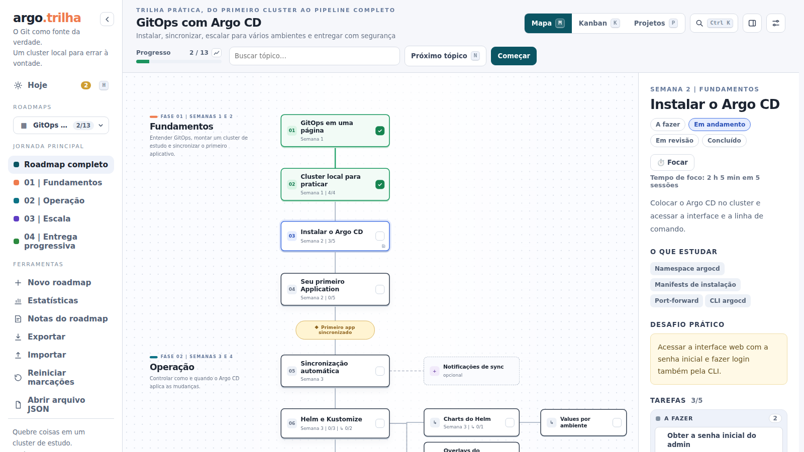
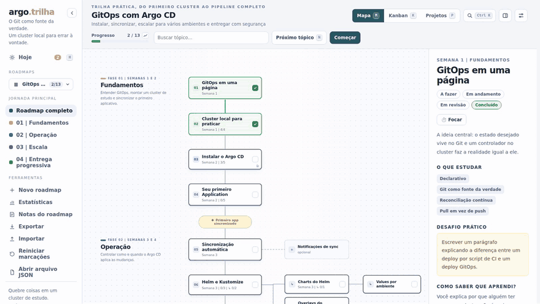
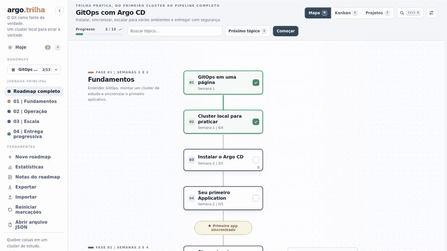
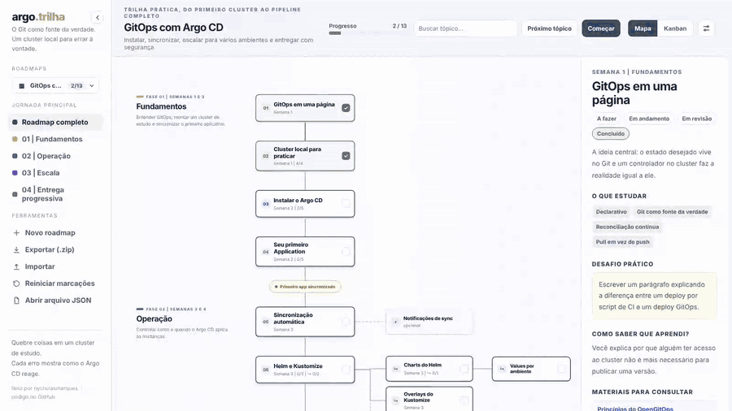

<h1 align="center">Roadkit</h1>

<p align="center">
  <a href="README.md">English</a> · <b>Português</b>
</p>

<p align="center">
  Roadmaps interativos que saem de um arquivo JSON.<br>
  Mapa, kanban e progresso salvo, num servidor que cabe em um arquivo Python.
</p>

<p align="center">
  <a href="https://github.com/nycholasmarques/roadkit/releases/latest"></a>
  <a href="https://github.com/nycholasmarques/roadkit/actions/workflows/ci.yml"></a>
  <a href="LICENSE"></a>
</p>

<p align="center">
  <picture>
    <source media="(prefers-color-scheme: dark)" srcset="docs/media/mapa-escuro.png">
    
  </picture>
</p>

<p align="center">
  <a href="#rodando">Rodando</a> ·
  <a href="#o-que-dá-pra-fazer">O que dá pra fazer</a> ·
  <a href="docs/README.md">Documentação</a> ·
  <a href="docs/criar-com-ia.md">Criar com IA</a>
</p>

## Por que existe

Eu queria ter vários roadmaps, tanto de projetos que quero tocar quanto de coisas que quero estudar, todos com a mesma cara e sem refazer a interface a cada um. A interface não sabe nada sobre o assunto: ela só desenha o que está no JSON. Para um roadmap novo, basta um arquivo, ou o editor que vem junto.

## Rodando

```bash
python3 tools/roadkit.py serve
```

Abra `http://localhost:8765`. Só precisa de Python 3: sem dependências, sem build. Os exemplos já aparecem na lista. Sem clonar o repositório, baixe o zip da [última release](https://github.com/nycholasmarques/roadkit/releases/latest).

<details>
<summary><b>Com Docker</b></summary>

Com a imagem publicada:

```bash
docker run -d -p 127.0.0.1:8765:8765 -v roadkit-data:/app/data ghcr.io/nycholasmarques/roadkit:1
```

Ou a partir do código, com o Compose:

```bash
docker compose up -d --build
```

O progresso e os roadmaps criados pela interface ficam num volume, então sobrevivem a rebuilds. No Compose, a pasta `./roadmaps` é montada somente leitura. Para abrir para o celular ou outro computador da rede, o token e as outras opções estão em [Docker e rede](docs/docker-e-rede.md).
</details>

## O que dá pra fazer

### Acompanhar

Cada tópico passa por a fazer, em andamento, em revisão e concluído, no **mapa** ou no **kanban**, e os dois mostram o mesmo estado. Tópicos têm tarefas e subtópicos; concluir o de cima conclui o que está embaixo. O progresso é salvo no servidor, então o que você marca no notebook aparece no celular.

<p align="center">
  
</p>

### Começar o dia

A tela **Hoje** junta todos os roadmaps: o que está em andamento, do que você mexeu por último para o mais antigo, e o próximo tópico de cada roadmap que você está usando. Ela pode ser a primeira coisa que o Roadkit abre.

### Ver o seu ritmo

**Estatísticas** mostra um mapa de calor dos últimos 12 meses, os dias seguidos e, para cada roadmap, o ritmo por semana e quando ele deve terminar nesse ritmo.

### Fazer projetos

Um roadmap pode trazer projetos práticos do iniciante ao avançado, cada um ligado aos tópicos que pratica. A tela **Projetos** mostra quais já estão ao seu alcance, e cada projeto tem requisitos para marcar e um lugar para o link do seu repositório.

### Anotar

Cada tópico e projeto tem um bloco de notas em Markdown, salvo no servidor e offline: o comando que funcionou, a dúvida, a decisão. A busca encontra o que você anotou, e as notas de um roadmap saem juntas em Markdown.

### Ir direto ao ponto

`Ctrl+K` busca qualquer tópico, projeto ou ação em todos os roadmaps, e atalhos de uma letra mudam a visualização, o tópico e o estado sem tirar a mão do teclado.

### Compartilhar

Exporte o roadmap em Markdown ou como uma página `.html` única que abre em qualquer navegador sem servidor, para mostrar o seu progresso a alguém.

### Instalar e usar offline

O Roadkit é um app instalável: abre em janela própria, com ícone, e depois da primeira vez funciona sem internet, com todos os roadmaps à mão. O que você marcar offline sobe quando a conexão voltar.

### Criar, vendo o resultado

**Novo roadmap** abre um editor com o formulário de um lado e o roadmap de verdade do outro, que se desenha enquanto você escreve. Dá para montar fases, tópicos, subtópicos até dois níveis, opcionais, cores, logo e categoria. Uma linha embaixo avisa o que está errado na hora.

<p align="center">
  
</p>

### Criar com uma IA

O botão **Criar com IA** monta um prompt a partir do que você quer aprender. Você leva até a IA que preferir, cola a resposta de volta, e o roadmap abre no editor para ajustar. Não precisa de chave de API. Quem usa um agente de código (Claude Code, Codex...) ainda ganha uma [skill](.agents/skills/roadkit/SKILL.md) que conduz essa conversa.

<p align="center">
  
</p>

### Organizar

Cada subpasta de `roadmaps/` vira uma seção no seletor, e o seletor mostra o andamento de cada roadmap. Dá para ocultar, duplicar, exportar com o progresso num `.zip` e importar de volta. As barras laterais se ajustam ou recolhem, e há sete temas, três claros e quatro escuros, que podem seguir o modo claro ou escuro do sistema.

## Seus roadmaps

Um roadmap é um arquivo JSON. O mínimo cabe em poucas linhas:

```json
{
  "id": "meu-roadmap",
  "meta": { "title": "Meu roadmap" },
  "nodes": [
    { "id": "primeiro", "title": "Primeiro tópico", "time": "Semana 1" },
    { "id": "segundo", "title": "Segundo tópico", "time": "Semana 2" }
  ]
}
```

Salve em `roadmaps/` (ou numa subpasta, que vira a categoria) e rode `python3 tools/roadkit.py check` para validar. Recarregue a página e ele aparece. Os exemplos em [`examples/`](examples/) mostram fases, tarefas, subtópicos, cores e rótulos próprios, em português e em inglês.

## Documentação

| | |
|---|---|
| [Usando a interface](docs/usando-a-interface.md) | um passeio pela tela |
| [Criando roadmaps](docs/criar-roadmaps.md) | três jeitos de criar, categorias e o que faz um bom roadmap |
| [Criando com IA](docs/criar-com-ia.md) | o botão e a skill |
| [Como funciona](docs/como-funciona.md) | o que roda onde, onde ficam os dados, a API |
| [Docker e rede](docs/docker-e-rede.md) | volumes, backup, token, outros aparelhos |
| [Formato do JSON](docs/SCHEMA.md) | referência de cada campo |
| [Publicando versões](docs/publicando-versoes.md) | versionamento, releases automáticas e [CHANGELOG](CHANGELOG.md) |

## Licença

MIT. Veja [`LICENSE`](LICENSE).
