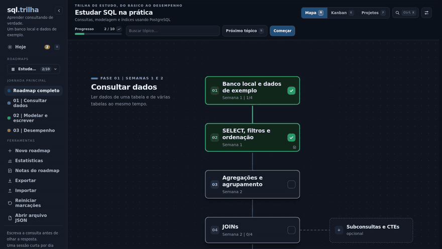
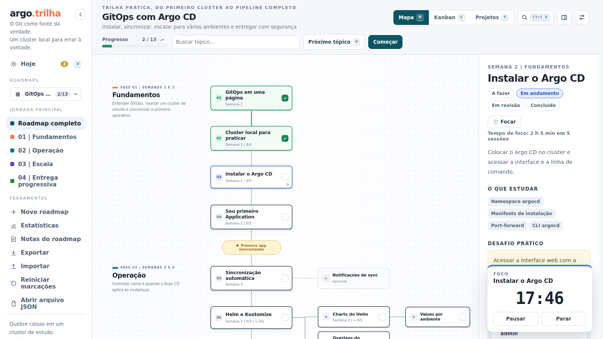

# O dia a dia: Hoje, revisão e foco

Três recursos para abrir o Roadkit todo dia. A **tela Hoje** junta o que fazer em todos os roadmaps; a **revisão espaçada** traz de volta o que você concluiu, antes de esquecer; e as **sessões de foco** medem o tempo real de cada tópico. A tela Hoje está sempre lá; as outras duas são opcionais e começam desligadas.

  

## A tela Hoje

**Hoje**, no topo da barra lateral (ou a tecla `H`), responde "o que eu faço agora?" juntando todos os roadmaps numa tela só:

- **Continuar**: os tópicos e projetos em andamento ou em revisão, de todos os roadmaps, do que você mexeu por último para o mais antigo. Cada linha mostra o roadmap, a fase, as tarefas feitas e quando foi a última mudança. Clicar abre o tópico no roadmap dele.
- **A seguir**: o próximo tópico a fazer de cada roadmap que você usou nos últimos 30 dias, com o andamento do roadmap e o prazo, se houver. Sem nenhuma atividade recente, aparece o próximo tópico do último roadmap aberto, em **Para começar**.

Roadmaps ocultos ficam de fora, e os que você nunca mexeu também (os estados escritos pelo autor no JSON não contam como seus). O botão com o nome do roadmap, ou `Esc`, volta para ele. Em **Ajustes → Ao abrir** dá para fazer o Roadkit abrir direto na tela Hoje.

## Revisão espaçada

Desligada por padrão. Com **Ajustes → Revisão espaçada** ligada, cada tópico principal que você concluir volta para revisão 3 dias depois, num bloco **Para revisar hoje** da tela Hoje, e o botão Hoje mostra quantas revisões venceram.

- **Ainda lembro** afasta a próxima revisão: 3, 7, 21, 60 e 150 dias. Depois da última, o tópico sai da fila.
- **Preciso rever** recomeça os intervalos, volta o tópico para "em revisão" e abre ele. Ele deixa de contar como concluído até você concluir de novo.

O que já estava concluído quando você liga a revisão não entra na fila: só o que você concluir dali em diante. Opcionais e subtópicos ficam de fora. A caixa **Revisar este roadmap**, nos ajustes, tira um roadmap da revisão (útil para os de projeto, que não são de estudo). O painel do tópico mostra quando é a próxima revisão. A fila fica no servidor, então vale em todos os aparelhos.

Em resumo, um tópico que você sempre lembra passa por cinco revisões em uns oito meses e depois sai da fila; um que você esquece volta ao começo, e você estuda de novo enquanto ainda é fácil.

## Sessões de foco

  

Desligadas por padrão. Com **Ajustes → Sessões de foco** ligadas, o painel de cada tópico e de cada projeto ganha um botão **Focar**. Ele abre um timer no canto da tela: escolha 25 ou 50 minutos, ou livre (um cronômetro), e comece. Se o tópico ainda estava "a fazer", o timer oferece movê-lo para "em andamento".

- O título da aba mostra o tempo restante, para você ver de outra aba. Recarregar a página ou trocar de roadmap não para o timer.
- No fim toca um som curto e, se você ligar **Avisar quando terminar**, aparece uma notificação do navegador. A permissão só é pedida quando você liga essa opção.
- Sessões de 5 minutos ou mais ficam registradas no tópico (inclusive quando você para antes do fim), e o painel mostra o total: "Tempo de foco: 3 h 20 min em 8 sessões". Offline, elas esperam numa fila e sobem quando o servidor voltar.
- Terminada uma sessão, dá para emendar uma pausa de 5 minutos, que não é registrada.

## Onde isso fica guardado

A tela Hoje não guarda nada: ela lê o progresso e o registro de atividade, que diz quando cada tópico foi mexido (veja [Estatísticas](estatisticas.md#de-onde-vêm-os-números)). A fila de revisão fica em `data/review.json` e o tempo de foco vai para o registro de atividade de cada roadmap, os dois no servidor, então valem em todos os aparelhos. Os detalhes estão em [Como funciona](como-funciona.md).
