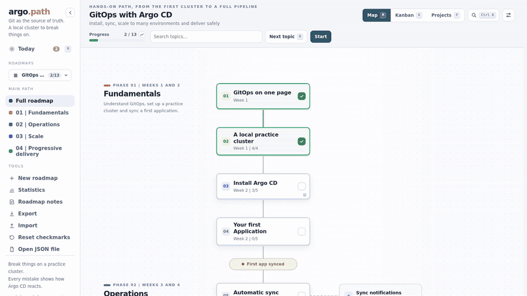

# Creating roadmaps

There are three ways to get a roadmap, and they all end in the same place: a JSON file. Pick whichever feels most comfortable.

## 1. With the editor in the interface

Click **New roadmap** (in the sidebar tools or at the bottom of the picker). The screen splits in two: the form on the left, and on the right the real roadmap, drawing itself as you type.

<p align="center">
  
</p>

The form covers what most roadmaps need: name, language, icon, subtitle, colors, logo, phases and topics. Each topic has a time estimate and, under "Details", a summary, what to study, tasks, a hands-on challenge, the success criterion and links.

A few things that help:

- **Sub-topics.** The "+ Sub-topic" button inside a topic creates a child, and a child can have children, up to two levels below the main topic. On the map they show up in columns to the right.
- **Optional.** Inside a sub-topic there is an "Optional" checkbox. Marking a topic as optional also marks everything below it (you can uncheck them one by one). A new sub-topic created under an optional one starts out optional.
- **Preview linked to the form.** Clicking a topic in the preview takes you to its field, and focusing a field selects the topic in the preview. A phase with no topics shows a dotted "Your topic here" card, just so you can see where it goes.
- **Problem line.** At the bottom, next to the Save button, a line says "No problems" or lists what is wrong (and what is only a warning, like a long title). These are the same rules as `check`, running as you type.
- **Projects.** After the topics comes the section for hands-on projects: name, level, time and, under "Details", the summary, the topics the project uses (one checkbox per topic), the requirements, the deliverable, the criterion and the ideas to go further. Focusing a project switches the preview to the Projects view. Format details in [`SCHEMA.md`](SCHEMA.md#projects-optional).
- **JSON tab.** The form does not cover everything: custom labels, the milestone at the end of a phase and other parts of the [format](SCHEMA.md) are only available in the JSON. The tab shows the whole file, the preview keeps working, and you can go back to the form at any time.

Roadmaps created here are stored in the server's data folder (`data/roadmaps/`), not in your `roadmaps/` folder. You can come back to edit them, change their category or delete them whenever you want. To move one into your own files, export it and copy the JSON out of the zip.

## 2. Writing the file

Copy an example into the `roadmaps/` folder and change it:

```bash
cp examples/en/minimal.json roadmaps/my-roadmap.json
python3 tools/roadkit.py check
```

`check` validates every JSON file and updates `manifest.json`. It reports errors (duplicate ids, a parent that does not exist, phases out of order, a link without `https://`) and warnings (unknown keys, long titles, a phase with no topics). Reload the page and the roadmap is already in the list.

Editor tip: the examples start with `"$schema": "../../schema/roadmap.schema.json"`, which gives you autocompletion and validation in VS Code. Adjust the path if your file lives in another folder.

The examples in `examples/` cover quite different situations and are worth a look before starting from scratch:

| File | What it shows |
|---|---|
| `minimal.json` | the smallest valid roadmap, with no phases |
| `sql.json` | a study track in phases, with hands-on projects |
| `argocd.json` | tasks per topic, sub-topics, optional topics and projects (it is the one in the GIFs) |
| `home-lab.json` | a personal project, with custom labels |
| `half-marathon.json` | a goal that has nothing to do with technology |
| `side-project.json` | a product project, with its own colors and labels |

They exist in English (`examples/en/`) and Portuguese (`examples/pt-BR/`), with the same content.

## 3. With an AI

Describe what you want and an AI writes the JSON. There is a button for it inside the editor and a skill for coding agents such as Claude Code. It is all in [Creating with AI](creating-with-ai.md).

## Categories

A roadmap's category is the folder it lives in. Each subfolder of `roadmaps/` becomes a section in the picker, and loose files go under "My roadmaps":

```
roadmaps/
  loose.json              → My roadmaps
  work/
    argocd.json           → Work
    migration.json
  studies/
    _section.json         → {"title": "Studies 2026"}
    sql.json              → Studies 2026
    cloud/
      networking.json     → Studies 2026 / Cloud
```

The section title is the folder name with the first letter capitalized. For a different title, put a `_section.json` with `{ "title": "..." }` inside the folder. Folders and files starting with `_` or `.` are ignored.

What matters is each roadmap's `id`, not the folder: moving a file to another folder does not lose its progress. Just do not reuse the same `id` in two files.

In the editor, the category is the field right above the form. It lists the sections that already exist and has a "New category…" option. A roadmap created in the interface appears in the same section as your files of that category, even though one lives in `roadmaps/studies/` and the other in `data/roadmaps/studies/`.

## What makes a roadmap pleasant to use

After building a few, these made the most difference:

**Short titles.** A card on the map has little room. "Install Argo CD" works; "Installation and initial configuration of Argo CD on the cluster" becomes a block of text. The limit is 60 characters, but you can go much shorter.

**A challenge you can check on your own.** "Understand Git" is not a challenge; "Undo a bad merge without losing work" is. The `challenge` field is what turns a topic into something to do, and `success` tells you when to stop.

**Tasks only when the topic really splits.** Three to six at most. Fifteen tasks in one topic is a sign it should be two topics (or that some of them are sub-topics).

**Sub-topics for what is part of the topic, optional for what is extra.** If the topic is not finished without it, it is a sub-topic. If it is "if there is time left", it is optional, and nothing waits on it.

**A small number of phases.** Three to five is usually enough. More than that and the sidebar becomes a table of contents. Give each one a period ("Weeks 1 and 2"), because that is what makes it feel like a path.

**Honest time estimates.** The `time` field is free text and does no math, but writing "Week 3" for something that takes three days fools you. Err on the long side.

**Stay under about 40 main topics.** Past that, split it into two roadmaps. `check` warns you.

**Projects that follow the path.** A beginner project uses the first topics; an advanced one combines many. If a beginner project's `uses` points to the last phase, it is not a beginner project. Two to four per level is usually enough.

**Never change the `id` of a roadmap you already use.** It is the key for the saved progress. You can change the title, the content, the order and even the folder, but the `id` stays.
