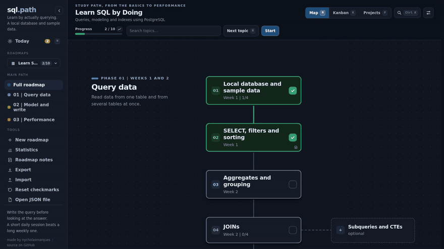
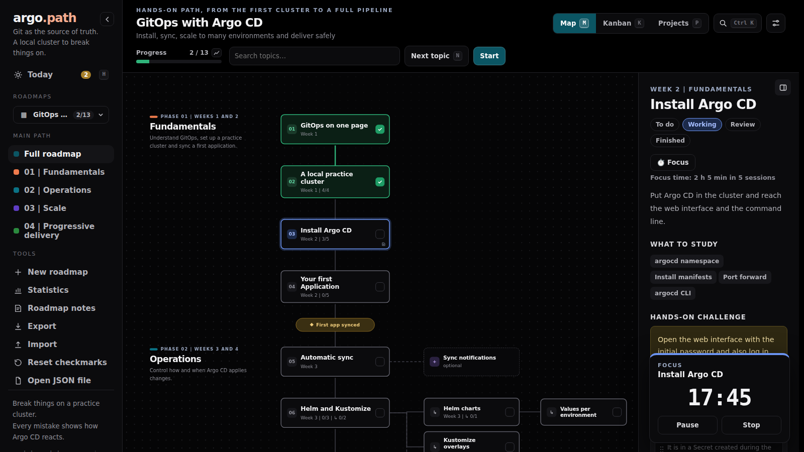

# Day to day: Today, review and focus

Three features made for opening Roadkit every day. The **Today screen** gathers what to do across every roadmap; **spaced review** brings back what you finished, before you forget it; and **focus sessions** measure the real time each topic takes. The Today screen is always there; the other two are optional and start turned off.

  

## The Today screen

**Today**, at the top of the sidebar (or the `H` key), answers "what do I do now?" by gathering every roadmap on one screen:

- **Continue**: topics and projects in progress or in review, from every roadmap, the one you touched last first. Each row shows the roadmap, the phase, the tasks done and when it last changed. Clicking opens the topic in its roadmap.
- **Up next**: the next topic to do in each roadmap you used in the last 30 days, with the roadmap's progress and the due date, if there is one. With no recent activity, the next topic of the last roadmap you opened shows up under **To get started**.

Hidden roadmaps are left out, and so are the ones you never touched (states the author wrote in the JSON do not count as yours). The button with the roadmap's name, or `Esc`, goes back to it. **Settings → On open** makes Roadkit open straight on the Today screen.

## Spaced review

Off by default. With **Settings → Spaced review** on, every main topic you finish comes back for review 3 days later, in a **To review today** block on the Today screen, and the Today button shows how many reviews are due.

- **I still remember** pushes the next review further: 3, 7, 21, 60 and 150 days. After the last one, the topic leaves the queue.
- **I need to review** starts the intervals over, moves the topic back to "in review" and opens it. It stops counting as finished until you finish it again.

What was already finished when you turn review on stays out of the queue: only what you finish from then on goes in. Optional topics and sub-topics are left out. The **Review this roadmap** box, in the settings, takes a roadmap out of review (handy for project roadmaps that are not about studying). The topic panel shows when the next review is. The queue lives on the server, so it works on every device.

In short, a topic you always remember goes through five reviews over about eight months and then leaves the queue; one you forget starts over, and you study it again while it is still easy.

## Focus sessions

  

Off by default. With **Settings → Focus sessions** on, the panel of every topic and project gets a **Focus** button. It opens a timer in the corner of the screen: pick 25 or 50 minutes, or open-ended (a stopwatch), and start. If the topic was still "to do", the timer offers to move it to "in progress".

- The tab title shows the time left, so you can see it from another tab. Reloading the page or switching roadmaps does not stop the timer.
- At the end a short sound plays and, if you turn on **Notify me when it ends**, a browser notification shows up. The permission is only asked when you turn that option on.
- Sessions of 5 minutes or more are recorded on the topic (even when you stop early), and the panel shows the total: "Focus time: 3 h 20 min in 8 sessions". Offline, they wait in a queue and go up when the server is back.
- After a session, you can take a 5-minute break, which is not recorded.

## Where this is stored

The Today screen stores nothing: it reads the progress and the activity record, which says when each topic was touched (see [Statistics](statistics.md#where-the-numbers-come-from)). The review queue lives in `data/review.json` and focus time goes into each roadmap activity record, both on the server, so they work on every device. The details are in [How it works](how-it-works.md).
