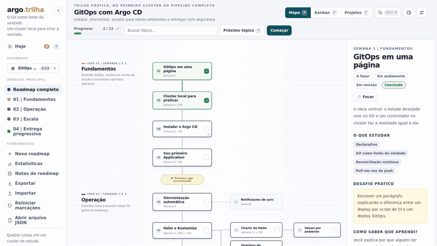

# Notes, export and share

What you learn does not fit in a "done". Notes keep the command that worked and the decision you made, and export takes everything out: to another machine, to a README or to a page anyone can open.

  

## Notes

Every topic and every project has a **My notes** box in its panel. It is yours, not part of the roadmap: the command that worked, the missing link, the open question, the decision you made in the project.

- **Write** opens a text box that grows with its content. The text saves itself half a second after you stop typing, and a line below says whether it reached the server ("Saved") or stayed in the browser. Without a server nothing is lost: the note goes up when it comes back.
- **View** shows the formatted text. It supports basic Markdown: headings (`#`), **bold**, *italics*, lists, `code`, code blocks, quotes, links and `- [ ]` checkboxes, which you can tick right there.
- Topics and projects with notes get an icon on their card, on the map, the kanban and the Projects view.
- The search box at the top also looks inside your notes.
- **Roadmap notes**, in the sidebar tools, gathers everything in one screen: a general note for the roadmap at the top and, below it, the notes of each topic and project in order, with a shortcut to each one. **Copy all as Markdown** takes the whole set to Obsidian, a README or an issue.

Notes go along with **Export** (a `notes.json` inside the zip) and come back with **Import**. Resetting checkmarks does not erase notes; deleting a roadmap with "erase progress and notes" does.

## Export, share and import

**Export** opens a menu with three outputs:

- **Roadmap and progress (.zip)**: a folder named after the roadmap, with the roadmap JSON, a `progress.json` and your notes inside. It is a way to take everything to another machine or keep a copy.
- **Markdown (.md)**: the roadmap as text, with phases as headings, `- [x]` on what is done, tasks, challenges, links, projects and, if you want, your notes at the end. It reads well on GitHub and in Obsidian.
- **Page to share (.html)**: a single file that opens in any browser **with no server and no internet**. It is Roadkit itself, with the map, the kanban, the projects and the panels, frozen at today's progress and read-only. A strip at the top says when the progress is from. Send it to a mentor or publish it on GitHub Pages. The "Include my notes" box decides whether your notes go along.

### Dates

In the same menu, **Roadmap start** takes the day you started (or will start). From it, phase periods and topic times ("Weeks 1 and 2", "Week 3", "Month 2") become dates: each phase flag on the map and each topic panel show "by Sep 14", and anything past its date and not done gets an amber warning. The date is yours and lives with your progress; roadmap authors can also set dates in the JSON (`startDate`, `due`), which win over computed ones. With no date at all, nothing changes on screen.

### Import

**Import** reads that zip back: if the roadmap already exists here, only the progress is applied; if it does not, it opens from the file (to keep it for good, copy the JSON into the `roadmaps/` folder). Import also accepts a bare `progress.json` or a roadmap JSON.

Dragging a `.json` onto the window, or using **Open JSON file**, shows a roadmap without storing anything on the server.
