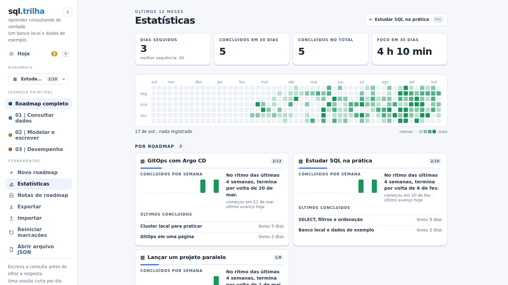
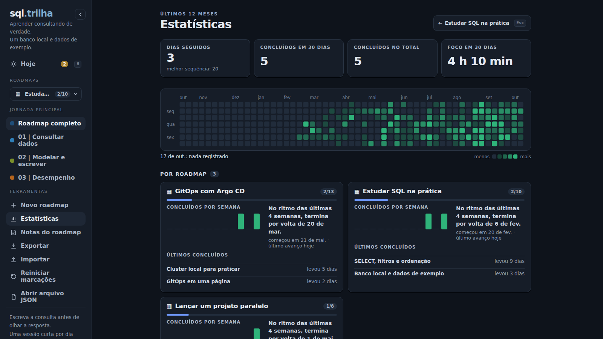

# Statistics

Studying takes weeks, not a day. The statistics screen shows that time: when you studied, at what pace each roadmap is moving and when it ends if you keep going like this.

  

## What the screen shows

**Statistics**, in the sidebar tools (or through the search, or the small chart next to the progress bar, which opens it on the open roadmap), shows what you did over time:

- **Numbers**: your day streak (with the best one of the year), topics finished in the last 30 days and in total, and focus time in the last 30 days, if you use focus sessions.
- **Heatmap** of the last 12 months, all roadmaps together: each square is a day, darker the more you did (state changes and focus). Hovering or tapping shows the day's numbers. On a phone it scrolls sideways and starts on today.
- **By roadmap**: progress, topics finished per week over the last 12 weeks and the **forecast**: "At the pace of the last 4 weeks, it ends around Nov 18". The forecast only shows up after two weeks of activity. Below it, the topics finished last and how long they took, compared with the topic's `time` when it is a duration ("2 weeks", "3 days").

The tone is a record, not a scorecard: losing a streak shows no warning at all. Statistics count from version 1.7, when the activity record started.

  

## Where the numbers come from

Every time a roadmap progress changes, the server writes the difference to that roadmap **activity record** (`data/activity/<id>.json`): how many changes and how many topics finished each day, and when each topic started and finished. Focus session time goes to the same place. The file has a bounded size (two years of daily totals; older days become monthly totals), so it does not grow with use.

Changes made with no internet land on the day they happened, not the day they synced: the browser keeps the time of each one until the server has it. And everything stays on your machine: nothing is sent anywhere, and there is no telemetry.

Since the record lives on the server, statistics do not show up in the [demo](https://nycholasmarques.github.io/roadkit/app/) or with the app open without a server. The format details are in [How it works](how-it-works.md#where-activity-is-stored).
