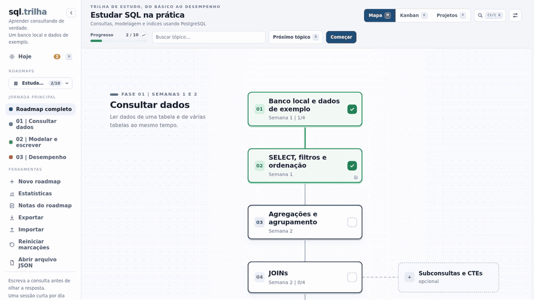
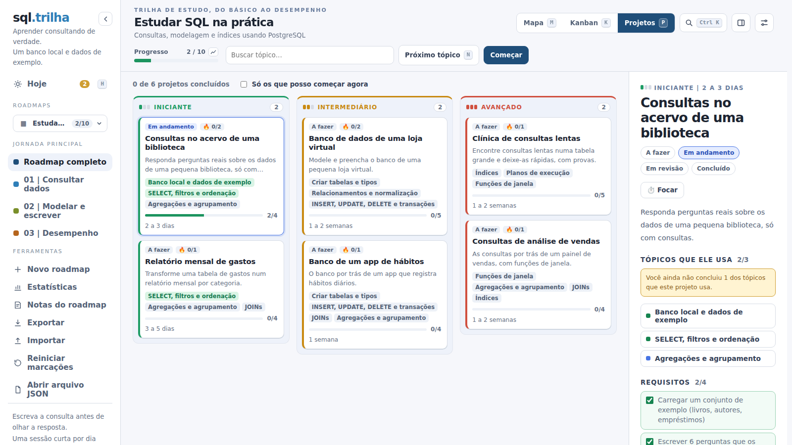

# Projetos

Um roadmap diz o que estudar; um projeto é onde você usa o que estudou. Projetos atravessam vários tópicos, vêm em três níveis (iniciante, intermediário e avançado) e têm o próprio andamento: requisitos, desafios extras e o link do seu repositório.

<p align="center">
  
</p>

## Na interface

Alguns roadmaps trazem projetos práticos, e aí aparece um terceiro botão: **Mapa / Kanban / Projetos**. A tela mostra uma coluna por nível (iniciante, intermediário e avançado; no celular, abas). Cada cartão diz o estado do projeto, os tópicos que ele usa (em verde os que você já concluiu) e quantos requisitos já estão marcados.

Um projeto fica **pronto para começar** quando todos os tópicos que ele usa estão concluídos. O cartão ganha um selo, e a caixa **Só os que posso começar agora** esconde o resto. Quando você conclui o tópico que faltava, um aviso aparece uma vez no rodapé da tela, com um atalho para o projeto.

Clicar num projeto abre o painel dele, com o mesmo jeito do painel de um tópico:

- os quatro estados (a fazer, em andamento, em revisão, concluído);
- os tópicos que ele usa, cada um com o seu estado, e um aviso discreto se ainda faltar algum. Não bloqueia nada;
- os **requisitos**, como caixas de marcar. Marcar o primeiro passa o projeto para "em andamento". Marcar o projeto como concluído marca todos, e voltar para "a fazer" desmarca todos, como acontece com as tarefas de um tópico;
- o entregável e o critério de sucesso;
- **Para ir além** 🔥: desafios extras, que também dá para marcar. Eles ficam em tons de fogo, e cada um que você encara acende a chama. Não contam para concluir o projeto, e o cartão mostra quantos você já fez (🔥 1/2);
- **Seu repositório**: cole o link do seu código para lembrar onde está. Ele fica salvo com o progresso e vira um botão para abrir.

No painel de um tópico, a seção **Projetos que usam este tópico** leva aos projetos ligados a ele. Os projetos não entram na barra de progresso do topo: ela continua medindo os tópicos principais, e a tela de projetos tem a própria contagem.

<p align="center">
  
</p>

## Escrevendo projetos no JSON

Projetos ficam num campo opcional `projects` do roadmap. Um projeto bom é pequeno o bastante para terminar e grande o bastante para usar mais de um tópico:

```jsonc
"projects": [
  {
    "id": "consultas-biblioteca",
    "title": "Consultas no acervo de uma biblioteca",
    "level": "beginner",
    "summary": "Responda perguntas reais sobre os dados de uma pequena biblioteca.",
    "uses": ["ambiente", "select", "agregacao"],
    "requirements": [
      { "id": "perguntas", "title": "Escrever 6 perguntas que os dados devem responder" },
      { "id": "consultas", "title": "Responder cada pergunta com uma consulta" }
    ],
    "deliverable": "Um repositório com o arquivo .sql e um README.",
    "stretch": ["Uma pergunta que precise de JOIN"],
    "time": "2 a 3 dias"
  }
]
```

- `uses` liga o projeto aos tópicos: quando todos estão concluídos, ele fica **pronto para começar**. É o que faz o projeto aparecer na hora certa.
- `requirements` vira um checklist; cada item tem um `id` que guarda o que você marcou.
- `stretch` são os desafios 🔥, que não contam para concluir.
- O **Criar com IA** e a skill para agentes sabem escrever projetos; peça junto com o roadmap.

A referência de cada campo, com os limites que o `check` aplica, está em [Formato do JSON](SCHEMA.md#projects-opcional).
