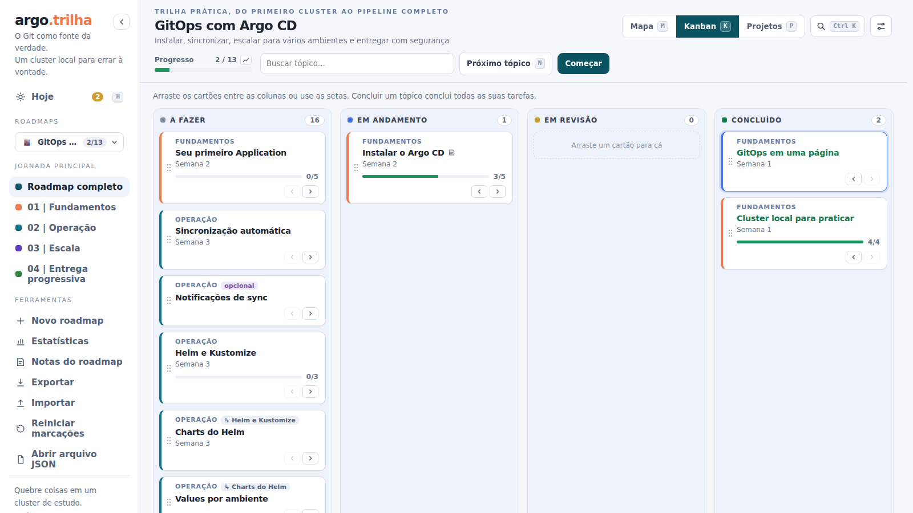

# Usando a interface

  

## O que tem na tela

Do lado esquerdo fica a barra lateral: o logo, o seletor de roadmaps, as fases do roadmap aberto e as ferramentas (novo roadmap, exportar, importar, reiniciar, abrir arquivo). No topo do conteúdo estão o título, a barra de progresso, a busca, os botões **Próximo tópico** e **Começar**, o seletor **Mapa / Kanban** e o botão de ajustes. Do lado direito aparece o painel de detalhes do tópico escolhido.

As duas barras laterais dá para arrastar pela borda para ficarem mais largas ou mais estreitas, e um duplo clique volta ao tamanho padrão. A da esquerda também recolhe para uma faixa só de ícones, pelo botão `‹` ao lado do logo, o que ajuda em telas pequenas. O que você escolher fica salvo no navegador.

## O mapa

O mapa desenha os tópicos principais em ordem, de cima para baixo, agrupados por fase. À direita do tópico ficam os subtópicos e as explorações opcionais, ligados por uma linha. Quando um tópico e o próximo estão concluídos, a linha entre eles fica verde.

Clique num tópico para ver o painel de detalhes: o resumo, o que estudar, o desafio prático, o critério para dar por concluído, as tarefas e os links. O quadradinho no canto do cartão marca como concluído sem abrir nada.

**Próximo tópico** pula para o primeiro que ainda não está concluído. **Começar** faz o mesmo e é o que aparece em destaque, porque é o que você quer na primeira vez.

## O kanban

O botão **Kanban** troca o mapa por um quadro com quatro colunas: a fazer, em andamento, em revisão e concluído. Cada tópico é um cartão. Arraste de uma coluna para outra com o mouse, ou use as setas que aparecem no cartão (útil no teclado e no celular).

  

O estado do tópico é o mesmo nas duas telas. Mover um cartão no kanban muda a cor no mapa, e vice-versa.

## Como o progresso é contado

Só os tópicos principais contam na barra de progresso do topo. Os outros níveis têm regras próprias:

- **Tarefas.** Um tópico pode ter uma lista de tarefas, que aparece como um kanban pequeno no painel de detalhes. O estado do tópico acompanha as tarefas: quando todas estão concluídas, ele também está. Marcar o tópico como concluído conclui todas as tarefas de uma vez, e reabrir o tópico reabre tudo.
- **Subtópicos.** Funcionam do mesmo jeito, só que com tópicos no lugar de tarefas. Um tópico com subtópicos obrigatórios só fica concluído quando todos estiverem. Os subtópicos não entram sozinhos na barra de progresso, quem entra é o tópico principal.
- **Opcionais.** Ficam do lado, com a borda tracejada, e não contam para nada. São para explorar se der vontade, sem travar o resto.

## O aviso de tópicos pulados

Se você move um tópico para frente no kanban sem ter concluído os anteriores, o cartão ganha um ícone de alerta. Clicar nele mostra, dentro do próprio cartão, o que ficou para trás. Não bloqueia nada, é só um lembrete. Em **Ajustes** dá para escolher a tolerância: avisar sempre, deixar passar até 3 ou 5 pendentes, ou nunca avisar.

## Trocando de roadmap

O seletor da barra lateral mostra cada roadmap com a sua barrinha de progresso, e um selo verde quando ele está concluído. Os roadmaps ficam em seções, que são as pastas onde estão os arquivos (veja [Criando roadmaps](criar-roadmaps.md#categorias)).

No rodapé do seletor está **Gerenciar roadmaps**, a lista completa. Dali dá para abrir, duplicar e ocultar qualquer roadmap, e editar ou excluir os que foram criados pela interface. Os que vêm de arquivos na pasta `roadmaps/` não podem ser apagados daqui, porque o servidor não mexe nos seus arquivos: ocultar tira da lista sem apagar nada, e dá para restaurar depois.

## Ajustes

O botão no canto superior direito abre os ajustes: modo (claro, escuro ou automático), tema, tamanho do texto, idioma da interface e a tolerância do aviso de pulados. O idioma em "automático" segue o `meta.language` do roadmap aberto. Escolher um idioma fixo vale para qualquer roadmap.

O modo diz se a tela é clara ou escura, e o tema escolhe as cores de cada um. Há três temas claros e quatro escuros:

| Tema | Modo | Para quê |
|---|---|---|
| Claro | claro | o padrão, branco e azulado |
| Névoa | claro | cinza suave: menos brilho em monitores grandes |
| Papel | claro | sépia quente, bom para ler por muito tempo |
| Noite | escuro | o padrão, escuro puxado para o azul |
| Grafite | escuro | escuro neutro, sem tom de azul |
| Ameixa | escuro | escuro com um toque de violeta |
| Breu | escuro | preto de verdade, para telas OLED e salas escuras |

No modo automático aparecem as duas fileiras: você escolhe um tema para quando o sistema está claro e outro para quando está escuro. Em todos eles o verde continua sendo "concluído" e o amarelo, "em revisão", e as cores do roadmap (`theme.accent`) continuam valendo. A escolha fica salva no navegador.

Na última linha dos ajustes aparece o estado do salvamento: se o progresso está sendo guardado no servidor ou só neste navegador.

## Exportar e importar

**Exportar** baixa um `.zip` com uma pasta com o nome do roadmap, e dentro dela o JSON do roadmap e um `progress.json`. É um jeito de levar tudo para outra máquina ou de guardar uma cópia. **Importar** lê esse zip de volta: se o roadmap já existe aqui, só o progresso é aplicado, e se não existe ele abre a partir do arquivo (para guardar de vez, copie o JSON para a pasta `roadmaps/`). Também aceita um `progress.json` solto ou um JSON de roadmap.

Arrastar um `.json` para a janela ou usar **Abrir arquivo JSON** mostra um roadmap sem guardar nada no servidor.

## No celular

Em telas estreitas o mapa vira uma linha do tempo de uma coluna só, com as fases como atalhos no topo, e o painel de detalhes abre por cima, como uma gaveta. O kanban ganha uma faixa fixa com as quatro colunas durante o arrasto, para soltar o cartão sem precisar rolar a página.
