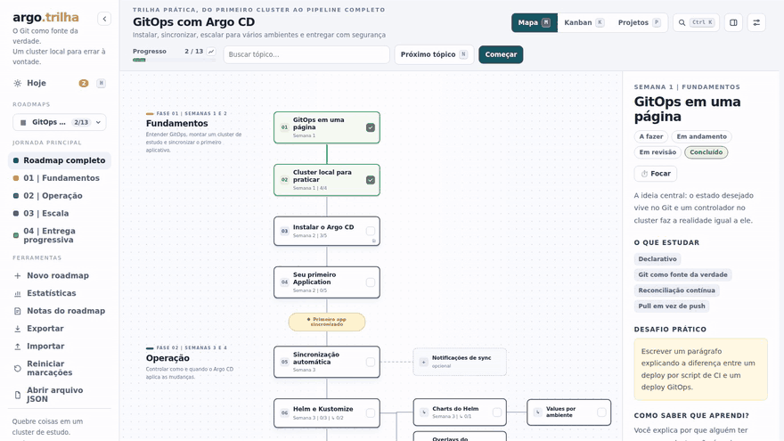
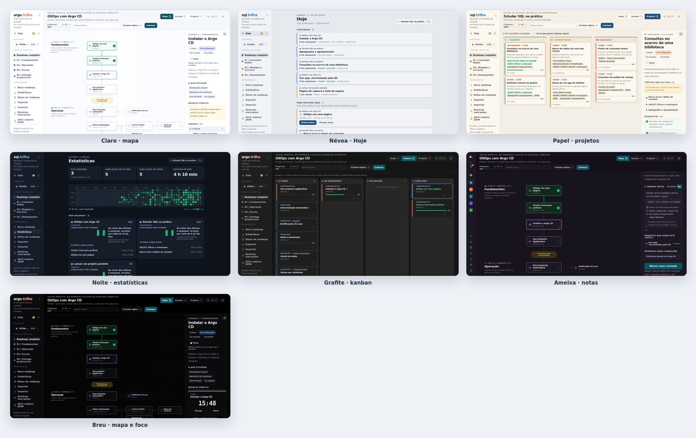
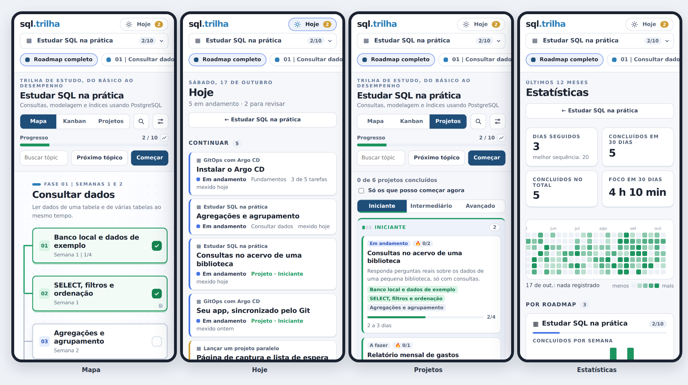

# Usando a interface

  

## O que tem na tela

Do lado esquerdo fica a barra lateral: o logo, o botão **Hoje**, o seletor de roadmaps, as fases do roadmap aberto e as ferramentas (novo roadmap, estatísticas, notas, exportar, importar, reiniciar, abrir arquivo). No topo do conteúdo estão o título, a barra de progresso (com um pequeno gráfico que abre as estatísticas desse roadmap), a busca do roadmap, os botões **Próximo tópico** e **Começar**, o seletor **Mapa / Kanban / Projetos**, a busca geral e os ajustes. Do lado direito abre o painel de detalhes, quando você escolhe um tópico ou um projeto.

As duas barras laterais dá para arrastar pela borda para ficarem mais largas ou mais estreitas, e um duplo clique volta ao tamanho padrão. A da esquerda recolhe para uma faixa de ícones pelo botão `‹` ao lado do logo. O painel da direita fica fechado até você clicar num tópico ou projeto (ou em **Próximo tópico**) e fecha pelo botão no canto dele ou com `Esc`. Em telas largas ele vira uma coluna ao lado do mapa; nas menores, abre por cima, como uma gaveta. Com a barra da esquerda recolhida e o painel fechado, sobra só o roadmap no centro. O que você escolher fica salvo no navegador.

## Aonde ir daqui

Os recursos maiores têm um guia próprio, com GIFs:

| Guia | Do que trata |
|---|---|
| [O dia a dia: Hoje, revisão e foco](dia-a-dia.md) | A tela que junta todos os roadmaps, a revisão espaçada e o timer de foco |
| [Projetos](projetos.md) | Projetos práticos por nível, na interface e no JSON |
| [Notas, exportar e compartilhar](notas-e-exportar.md) | Notas em Markdown, o .zip, o Markdown, a página para compartilhar e as datas |
| [Estatísticas](estatisticas.md) | Mapa de calor, sequência, ritmo e previsão, e de onde vêm os números |

## O mapa

  

O mapa desenha os tópicos principais em ordem, de cima para baixo, agrupados por fase. À direita do tópico ficam os subtópicos e as explorações opcionais, ligados por uma linha. Quando um tópico e o próximo estão concluídos, a linha entre eles fica verde.

Clique num tópico para ver o painel de detalhes: o resumo, o que estudar, o desafio prático, o critério para dar por concluído, as tarefas e os links. O quadradinho no canto do cartão marca como concluído sem abrir nada.

**Próximo tópico** pula para o primeiro que ainda não está concluído. **Começar** faz o mesmo e é o que aparece em destaque, porque é o que você quer na primeira vez.

## O kanban

O botão **Kanban** troca o mapa por um quadro com quatro colunas: a fazer, em andamento, em revisão e concluído. Cada tópico é um cartão. Arraste de uma coluna para outra com o mouse, ou use as setas que aparecem no cartão (útil no teclado e no celular).

  

O estado do tópico é o mesmo nas duas telas. Mover um cartão no kanban muda a cor no mapa, e vice-versa.

## Como o progresso é contado

Só os tópicos principais contam na barra de progresso do topo. Os outros níveis têm regras próprias:

- **Tarefas.** Um tópico pode ter uma lista de tarefas, que aparece como um kanban pequeno no painel de detalhes. O estado do tópico acompanha as tarefas: quando todas estão concluídas, ele também está. Marcar o tópico como concluído conclui todas as tarefas de uma vez, e reabrir o tópico reabre tudo.
- **Subtópicos.** Funcionam do mesmo jeito, só que com tópicos no lugar de tarefas. Um tópico com subtópicos obrigatórios só fica concluído quando todos estiverem. Os subtópicos não entram sozinhos na barra de progresso, quem entra é o tópico principal.
- **Opcionais.** Ficam do lado, com a borda tracejada, e não contam para nada. São para explorar se der vontade, sem travar o resto.

## O aviso de tópicos pulados

Se você move um tópico para frente no kanban sem ter concluído os anteriores, o cartão ganha um ícone de alerta. Clicar nele mostra, dentro do próprio cartão, o que ficou para trás. Não bloqueia nada, é só um lembrete. Em **Ajustes** dá para escolher a tolerância: avisar sempre, deixar passar até 3 ou 5 pendentes, ou nunca avisar.

## Trocando de roadmap

O seletor da barra lateral mostra cada roadmap com a sua barrinha de progresso, e um selo verde quando ele está concluído. Os roadmaps ficam em seções, que são as pastas onde estão os arquivos (veja [Criando roadmaps](criar-roadmaps.md#categorias)).

No rodapé do seletor está **Gerenciar roadmaps**, a lista completa. Dali dá para abrir, duplicar e ocultar qualquer roadmap, e editar ou excluir os que foram criados pela interface. Os que vêm de arquivos na pasta `roadmaps/` não podem ser apagados daqui, porque o servidor não mexe nos seus arquivos: ocultar tira da lista sem apagar nada, e dá para restaurar depois.

## Busca e atalhos de teclado

  

`Ctrl+K` (`⌘K` no Mac), ou a lupa no topo, abre uma busca que vai para qualquer lugar: tópicos e projetos de **todos** os roadmaps, os próprios roadmaps e as ações (novo roadmap, exportar, notas, trocar de visualização, alternar o modo, ajustes). A busca ignora acentos e maiúsculas e aceita letras pulando no meio, como "kstmz" para Kustomize. Os resultados do roadmap aberto vêm primeiro, cada tópico com o roadmap, a fase e o estado. `↑` `↓` escolhem, `Enter` abre e `Esc` fecha. Com a caixa vazia, aparecem os itens abertos por último.

Fora de campos de texto, algumas teclas de uma letra funcionam direto:

| Tecla | O que faz |
|---|---|
| `/` | vai para a busca do topo |
| `M` · `K` · `P` | Mapa, Kanban, Projetos |
| `H` | abre ou fecha a tela Hoje |
| `N` | próximo tópico a fazer |
| `J` · `L` | tópico anterior / seguinte, na ordem do caminho |
| `1` · `2` · `3` · `4` | a fazer, em andamento, em revisão, concluído, no tópico ou projeto aberto |
| `T` | alterna entre modo claro e escuro |
| `?` | mostra a lista de atalhos |

No computador, os botões que têm atalho mostram a tecla ao lado (`H` em Hoje, `N` em Próximo tópico, `M` `K` `P` nas visualizações, `Ctrl K` na lupa), para você ir decorando. Em **Ajustes → Atalhos de teclado** dá para desligar as teclas de uma letra (para quem usa leitor de tela ou extensões que já usam essas teclas); `Ctrl+K` e `Esc` continuam. No celular, a busca abre pela lupa e ocupa a tela inteira.

## Ajustes e temas

O botão no canto superior direito abre os ajustes: modo (claro, escuro ou automático), tema, tamanho do texto, idioma da interface, o que abrir primeiro (o último roadmap ou a tela Hoje), a revisão espaçada, as sessões de foco e a tolerância do aviso de pulados. O idioma em "automático" segue o `meta.language` do roadmap aberto. Escolher um idioma fixo vale para qualquer roadmap.

O modo diz se a tela é clara ou escura, e o tema escolhe as cores de cada um. Há três temas claros e quatro escuros:

  

| Tema | Modo | Para quê |
|---|---|---|
| Claro | claro | o padrão, branco e azulado |
| Névoa | claro | cinza suave: menos brilho em monitores grandes |
| Papel | claro | sépia quente, bom para ler por muito tempo |
| Noite | escuro | o padrão, escuro puxado para o azul |
| Grafite | escuro | escuro neutro, sem tom de azul |
| Ameixa | escuro | escuro com um toque de violeta |
| Breu | escuro | preto de verdade, para telas OLED e salas escuras |

No modo automático aparecem as duas fileiras: você escolhe um tema para quando o sistema está claro e outro para quando está escuro. Em todos eles o verde continua sendo "concluído" e o amarelo, "em revisão", e as cores do roadmap (`theme.accent`) continuam valendo. A escolha fica salva no navegador.

Na última linha dos ajustes aparece o estado do salvamento: se o progresso está sendo guardado no servidor ou só neste navegador.

## Instalar e usar sem internet

O Roadkit é um app instalável (PWA). No Chrome e no Edge, o ícone de instalar aparece na barra de endereço, e **Ajustes → Instalar como app** faz o mesmo. Instalado, ele abre em janela própria, com ícone, e pode ficar na barra de tarefas ou na tela inicial do celular. No iPhone, use **Compartilhar → Adicionar à Tela de Início**.

Depois de aberto uma vez, o Roadkit **abre sem internet**: a interface fica guardada no navegador, junto com uma cópia de todos os roadmaps da lista, mesmo os que você nunca abriu nesse aparelho. Sem conexão, você continua marcando progresso e escrevendo notas; a linha dos ajustes avisa que está salvando só neste aparelho, e tudo sobe para o servidor quando a conexão volta.

Quando sai uma versão nova do Roadkit, uma faixa discreta no rodapé diz **Nova versão disponível · Recarregar**. Ele nunca recarrega sozinho, para não interromper o que você está escrevendo.

Isso funciona em `http://localhost` e em qualquer endereço com HTTPS. Para usar de outro aparelho da rede, veja [Docker e rede](docker-e-rede.md#app-instalável-e-https).

Para experimentar sem instalar nada, há uma [demonstração](https://nycholasmarques.github.io/roadkit/app/) no site do Roadkit: é o mesmo app, com os roadmaps de exemplo, e o progresso fica só no navegador. Criar e editar roadmaps, as estatísticas e a sincronização entre aparelhos precisam do servidor; um aviso na barra lateral diz isso e pode ser escondido por 30 dias.

## No celular

  

Em telas estreitas o mapa vira uma linha do tempo de uma coluna só, com as fases como atalhos no topo, e o painel de detalhes abre por cima, como uma gaveta. O kanban ganha uma faixa fixa com as quatro colunas durante o arrasto, para soltar o cartão sem precisar rolar a página.
